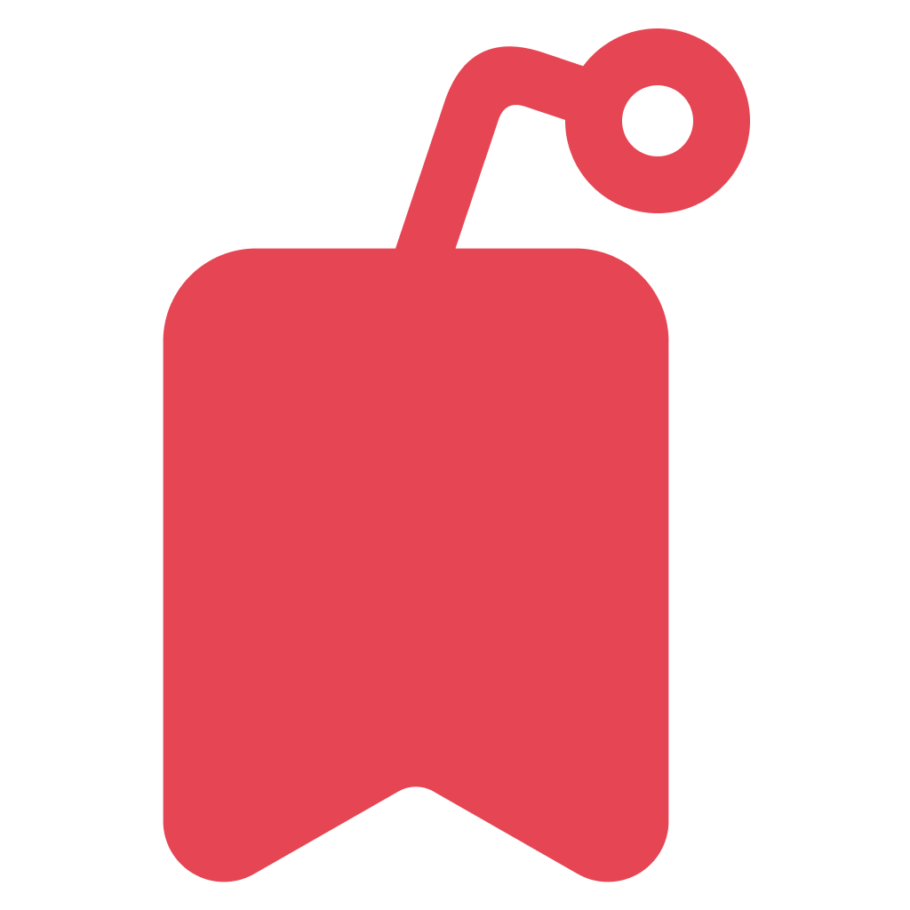

  

<h1 align="center">Savedex</h1>

  Reddit saved library manager for browsing, organizing, searching, and backing up your saved posts and comments locally.

  
  

---

---

## Features

- **Reddit API Sync & Takeout Import:** Sync up to 1,000 recent saves directly via Reddit OAuth, or import your complete history from a Reddit GDPR Takeout `.zip` / `.csv`.
- **Search & Filter:** Filter by media type, subreddit, author, flair, date range, or NSFW status, and search locally across saved posts, comments.
- **Organize Your Library:** Group saves into custom collections, add personal notes, star favorites, and browse by subreddit or user.
- **Archive Recovery:** Recover content removed from Reddit using Arctic Shift and PullPush archive fallbacks.
- **Backup & Restore:** Export compressed `.savedex`, JSON, and CSV and restore your whole library anytime between diffrent devices.

---

## Get Started

1. **Configure Reddit API credentials:** Open **Settings → Reddit Account** and enter your OAuth Client ID, Redirect URI, and User Agent.
2. **Sign in with Reddit (recommended):** Authorizing your account speeds up post, comment, and media metadata fetching and lets you sync up to your last **1,000 saves** directly from Reddit.
3. **Import older saves via Reddit Takeout:** Have more than 1,000 saved items? Request your account data from [reddit.com/settings/data-request](https://www.reddit.com/settings/data-request), then import the `.zip` or `.csv` file in **Settings → Import & Sync**.
4. **Organize & back up:** Filter and search your saves, group items into collections, and create snapshots or JSON/CSV exports in **Settings → Backup & Restore**.

### Where do I get a Client ID?

Use [RedReader](https://github.com/QuantumBadger/RedReader/releases/latest) and log in, RedReader will email you the OAuth ID, or you can simply Google it along with its Redirect URI and User Agent.

---

## Download & Installation

Binaries compiled by GitHub Actions for all supported platforms are available on the [**GitHub Releases**](https://github.com/neon16bit/savedex/releases/latest) page.

| Platform | Download |
| :--- | :--- |
| **Android** | [-3DDC84?style=flat-square&logo=android&logoColor=white)](https://github.com/neon16bit/savedex/releases/latest) [-3DDC84?style=flat-square&logo=android&logoColor=white)](https://github.com/neon16bit/savedex/releases/latest) |
| **Windows** | [-0078D6?style=flat-square&logo=windows&logoColor=white)](https://github.com/neon16bit/savedex/releases/latest) [-0078D6?style=flat-square&logo=windows&logoColor=white)](https://github.com/neon16bit/savedex/releases/latest) |
| **Linux** |   |
| **macOS** | [-000000?style=flat-square&logo=apple&logoColor=white)](https://github.com/neon16bit/savedex/releases/latest) |

---

## License

Savedex is licensed under the [GNU General Public License v3.0](LICENSE).
